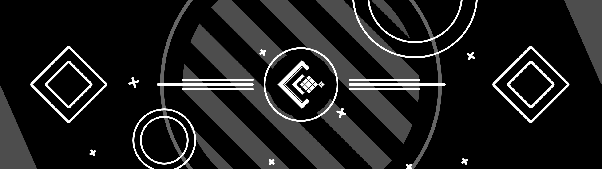

  

  

  <i>Building Minecraft Add-ons, writing scripts, and breaking random things just to see how they work.</i>

  

<table align="center">
  <tr>
    <td align="center" width="33%">
      <h3>🧱</h3>
      <b>Minecraft Add-ons</b> 
      Custom blocks, items, entities &amp; gameplay systems
    </td>
    <td align="center" width="33%">
      <h3>⚙️</h3>
      <b>Scripting</b> 
      JavaScript &amp; TypeScript logic that brings add-ons to life
    </td>
    <td align="center" width="33%">
      <h3>🧪</h3>
      <b>Experiments</b> 
      Always poking at something new — right now: Rust
    </td>
  </tr>
</table>

  

<h3 align="center">Toolbox</h3>

  

  Currently learning 
  

  

  
  

